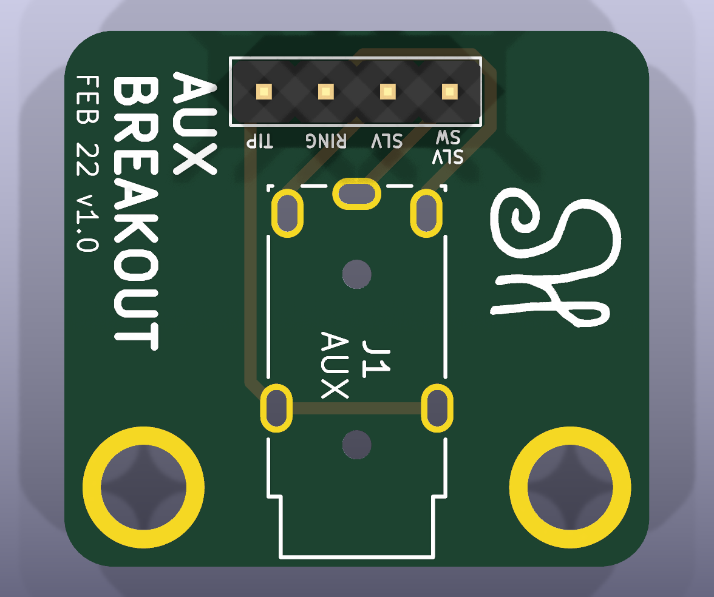

# Aux Breakout Board

> A small KiCad breakout board that brings each contact of a 3.5mm TRS aux jack out to a labeled 4-pin 2.54mm header for breadboards and prototypes.

<p align="center">
  
</p>

## Table of Contents

- [Overview](#overview)
- [Functionality](#functionality)
  - [Pinout](#pinout)
  - [Board Specifications](#board-specifications)
- [System Design](#system-design)
  - [Hardware](#hardware)
  - [Software](#software)
- [Bill of Materials](#bill-of-materials)
- [Author](#author)
- [AI Disclosure](#ai-disclosure)
- [License](#license)

## Overview

Panel-mount and PCB-mount 3.5mm jacks don't fit a breadboard, and their pins are hard to identify without a datasheet. This board solves both problems: a through-hole 3.5mm stereo jack sits on a small two-layer PCB, and each of its contacts is routed to a standard 0.1" pin header labeled on the silkscreen. The header plugs straight into a breadboard or takes Dupont jumpers, which makes it useful for audio signals, Morse keyer paddles, or any other project that uses a 3.5mm connector.

This was a personal project, designed in KiCad. Gerbers for revision v1.0 are included and ready to send to a board house.

## Functionality

### Pinout

| Header Pin | Silkscreen | Jack Contact | Typical Use |
|---|---|---|---|
| 1 | SLV SW | Sleeve switch | Plug-detect (opens/closes when a plug is inserted) |
| 2 | SLV | Sleeve | Ground |
| 3 | RING | Ring | Right audio / second signal |
| 4 | TIP | Tip | Left audio / first signal |

### Board Specifications

| Spec | Value |
|---|---|
| Dimensions | 24 mm x 22 mm, rounded corners |
| Layers | 2 (F.Cu, B.Cu) |
| Mounting | 2x M3 plated mounting holes |
| Connector | 1x4 2.54mm vertical pin header |
| Jack | 3.5mm stereo (TRS) with sleeve switch, through-hole |
| Revision | v1.0 (Feb 22, 2026) |

## System Design

### Hardware

| Component | Details |
|---|---|
| J1 | Tensility 54-00174 3.5mm stereo jack |
| J2 | Molex 0022232041 1x4 2.54mm vertical header |

The schematic is a direct one-to-one connection from each jack contact to a header pin. The schematic is available as [`assets/schematic.svg`](/assets/schematic.svg).

### Software

No firmware. The board is purely passive. All design files were made in **KiCad 10**.

```
Aux-Breakout-Board/
├── assets/
│   ├── pcb_render_top.png              # 3D render of the board
│   └── schematic.svg                   # Schematic export
└── hardware/
    ├── aux_breakout_board.kicad_pro    # KiCad project
    ├── aux_breakout_board.kicad_sch    # Schematic
    ├── aux_breakout_board.kicad_pcb    # PCB layout
    └── gerbers/
        └── aux_breakout_board_v1.0.zip # Fabrication files (Gerbers + drill)
```

## Bill of Materials

| Item | Part Number | Digi-Key | Qty |
|---|---|---|---|
| 3.5mm stereo jack | Tensility 54-00174 | - | 1 |
| 1x4 2.54mm header | Molex 0022232041 | WM4202-ND | 1 |
| PCB | - | - | 1 |

## Author

**Seth Hibpshman**  
Student of Electrical Engineering, Eastern Washington University

## AI Disclosure
_AI (LLM) tools were used in the drafting and editing of this README; the PCB was designed by hand._

## License

[GNU General Public License v3.0](LICENSE)
